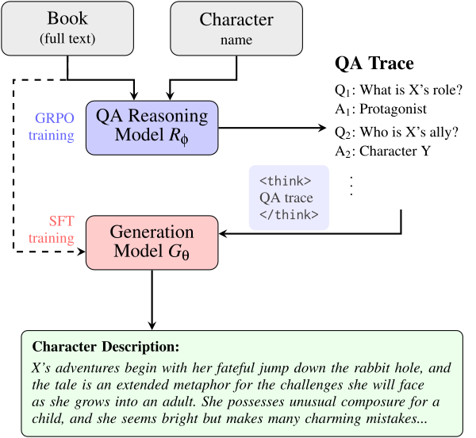

# qa-guided-reasoning

Code for our paper, **Think Before you Write: QA-Guided Reasoning for Character
Descriptions in Books** (ACL Findings 2026)
[[Paper]](https://aclanthology.org/2026.findings-acl.1259/).

<p align="center">
  <a href="https://aclanthology.org/2026.findings-acl.1259/">
    
  </a>
</p>

### Repository Structure

```text
config/         YAML configs for generation, QA, SFT, and GRPO data preparation
src/data/       data preparation
src/models/     eval.py, finetune.py, qwen/, qa_reasoning/, rl/
src/utils/      data, prompt, and training helpers
prompts/        BookWorm, CroSS, and reward prompts
data/           folder to place datasets
scripts/rl/     judge and GRPO launchers
```

### Python Environment

Install dependencies with `uv`. Choose the group based on what you want to do: `inference` for generation, `sft` for supervised fine-tuning, or `rl` for reinforcement learning. For example, for generation:


```bash
uv sync --group inference
```

### Data

We use [BookWorm](https://github.com/apapoudakis/BookWorm) for training and evaluation,
and [CroSS](https://github.com/Joanna0123/character_profiling) for out-of-distribution evaluation.
Follow the authors' instructions in each repository to obtain and prepare the data.
Place the datasets in `data/raw/BookWorm/` and `data/raw/CroSS/`, respectively.

### Reasoning Training

We train the QA-guided reasoning model with QA pairs extracted from
gold descriptions. Configure `config/rl/prepare.yaml`, and run:

```bash
uv run python -m src.models.rl.prepare_data --config config/rl/prepare.yaml
```

Prepare both `train.jsonl` and `validation.jsonl` for the RL dataset. Start the
judge and training job in separate terminals; the default setup uses one judge
GPU and four training GPUs:

```bash
CUDA_VISIBLE_DEVICES=4 bash scripts/rl/judge.sh
```

```bash
CUDA_VISIBLE_DEVICES=0,1,2,3 bash scripts/rl/ppo_openrlhf.sh
```

### Generate QA Traces

Set the reasoner's `eval_params.checkpoint_path` in `config/qa/qa_generation.yaml`
to the RL model's Hugging Face checkpoint, or leave it `null` to use the base model.

```bash
uv run python -m src.models.qa_reasoning.qa --config config/qa/qa_generation.yaml
```

### Fine-Tune Generation Model

`finetune.py` trains the description model using the settings in `config/train.yaml`.

Leave `qa_data_path: null` for standard SFT without reasoning traces. To include
QA traces, set `qa_data_path` to the directory containing `train.jsonl` and
`val.jsonl` with per-seed QA fields.

```bash
uv run python -m src.models.finetune --config config/train.yaml
```

### Generate Character Descriptions

`eval.py` generates character descriptions for the different settings of our experiments, including truncate, hierarchical, incremental processing or retrieval. Configure the method and prompt in `config/eval.yaml`


Leave `checkpoint_path: null` for zero-shot generation, or provide a trained
generation-model checkpoint. To use previously generated QA traces, set
`qa_data_path` to the directory containing combined `preds.jsonl`,
`guided_reasoning: true`, and `built_in_thinking: false`. 
Leave `qa_data_path: null` and `guided_reasoning: false` to run without supplied traces.

```bash
uv run python -m src.models.eval --config config/eval.yaml
```

### Citation

```bibtex
@inproceedings{papoudakis-etal-2026-think,
    title = "Think Before you Write: {QA}-Guided Reasoning for Character Descriptions in Books",
    author = "Papoudakis, Argyrios and Lapata, Mirella and Keller, Frank",
    booktitle = "Findings of the Association for Computational Linguistics: ACL 2026",
    year = "2026",
    publisher = "Association for Computational Linguistics",
    url = "https://aclanthology.org/2026.findings-acl.1259/",
    doi = "10.18653/v1/2026.findings-acl.1259",
    pages = "25144--25164"
}
```
